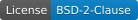
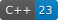

# C++

[](LICENSE)


Монорепозиторий для C++.

## Приложения

+ [Password Generator](./apps/password_generator)
+ [Password Manager](./apps/password_manager)
+ [Sapper](./apps/sapper)
+ [Money Manager](./apps/money_manager)

## Библиотеки

+ [common](./libs/common)
+ [cryptography](./libs/cryptography)
+ [pwdgen](./libs/pwdgen)
+ [qthelpers](./libs/qthelpers)

## Сборка

Проект собирается на следующем окружении:
* Alt Linux p11
* GCC 16.2.0
* CMake 3.31.7
* Qt 6.11.2
* libcrypto 3.5.7
* libxerces-c 3.2.5
* GTest 1.17.0

Для сборки проекта нужно определить переменную окружения `GCC_HOME`, например:

```sh
export GCC_HOME=/opt/gcc-16.2.0
```

Запуск сборки:

```sh
cmake . --preset <debug | release>
cmake --build --preset <debug | release> [--target <target>]
```

Цели для сборки приложений:
* password_generator
* password_manager
* sapper
* money_manager
 
## Тесты

```sh
cmake --build --preset <debug | release>
ctest --preset <debug | release>
```

или


```sh
cmake --workflow --preset <debug | release>
```

## Запуск

Если используется компилятор не из дистрибутива, то нужно определить переменную `LD_LIBRARY_PATH`, например:

```sh
LD_LIBRARY_PATH=$GCC_HOME/lib64 ./password_generator
```

## Сторонние исходные тексты

+ Boost 1.92.0
    + [Boost.Assert](https://www.boost.org/library/1.92.0/assert/)
    + [Boost.Config](https://www.boost.org/library/1.92.0/config/)
    + [Boost.Decimal](https://www.boost.org/library/1.92.0/decimal/)
    + [Boost.ThrowException](https://www.boost.org/library/1.92.0/throw_exception/)
    + [Boost.TypeTraits](https://www.boost.org/library/1.92.0/type_traits/)
    + [Boost.Uuid](https://www.boost.org/library/1.92.0/uuid/)

## Разное

[Заметки по опыту использования модулей C++20](docs/modules.md)
